<picture>
  <source media="(prefers-color-scheme: light)" srcset="assets/id-light.svg">
  
</picture>

---

## 🚀 What I'm Working On

- Learning **Linux system programming**
- Exploring **embedded networking and firmware development**
- Building projects on **MCU platforms and Linux environments**

---

## 🛠 Tech Stack

### Programming

### Embedded / Systems

### Tools

---

## 📊 Most Used Languages

<picture>
  <source media="(prefers-color-scheme: light)" srcset="assets/langs-light.svg">
  
</picture>

---

## 🎓 Education

| | |
|---|---|
| 🎓 **M.S.** | National Yang Ming Chiao Tung University |
| 🏫 **B.S.** | National Chung Cheng University |

---

## 🌱 Interests

- Linux kernel and system programming
- Embedded firmware development
- Networking systems and protocol design

---

Feel free to reach out if you'd like to talk about  
**Linux, Embedded Systems, or Networking**

