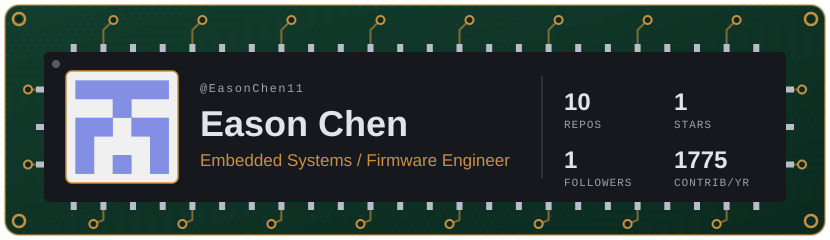
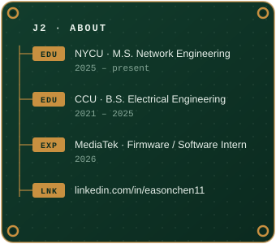
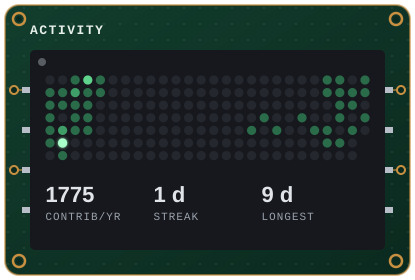
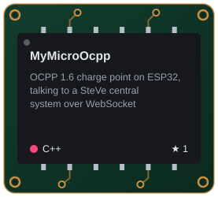
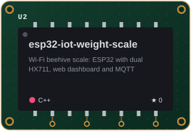
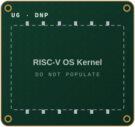
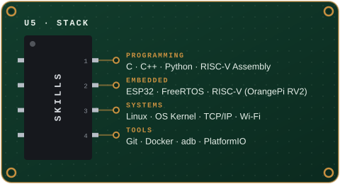

<picture><source media="(prefers-color-scheme: light)" srcset="assets/id-light.svg"></picture>

<picture><source media="(prefers-color-scheme: light)" srcset="assets/about-light.svg"></picture>
<picture><source media="(prefers-color-scheme: light)" srcset="assets/activity-light.svg"></picture>

<a href="https://github.com/EasonChen11/MyMicroOcpp"><picture><source media="(prefers-color-scheme: light)" srcset="assets/repo-1-light.svg"></picture></a>
<a href="https://github.com/EasonChen11/esp32-iot-weight-scale"><picture><source media="(prefers-color-scheme: light)" srcset="assets/repo-2-light.svg"></picture></a>
<picture><source media="(prefers-color-scheme: light)" srcset="assets/repo-3-light.svg"></picture>

<picture><source media="(prefers-color-scheme: light)" srcset="assets/stack-light.svg"></picture>

  <a href="https://www.linkedin.com/in/easonchen11/">LinkedIn</a> ·
  <a href="https://github.com/EasonChen11">GitHub</a>

